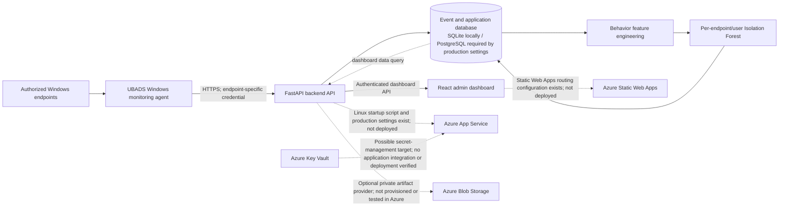
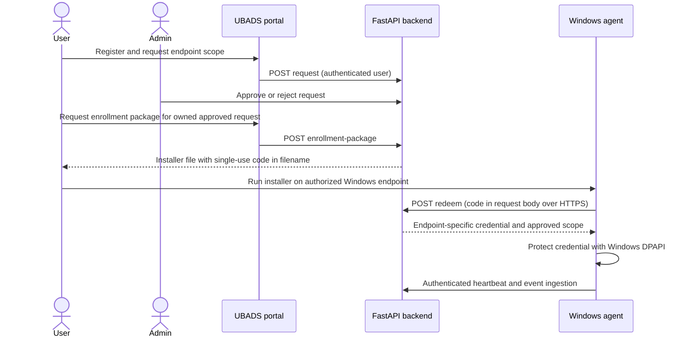

# UBADS — User Behavior Anomaly Detection System

## 1. Project title and overview

UBADS is a research-oriented system for collecting authorized Windows security-event metadata, grouping activity into user and time-window profiles, and identifying behavior that differs from a learned baseline. It includes a Windows endpoint agent, a FastAPI backend, a React dashboard, SQL-backed event storage, feature engineering, and an Isolation Forest anomaly-detection prototype.

An anomaly score is a relative model score, not a probability. A detection is an investigation signal, not proof of malicious activity. Run the collector or agent only on endpoints whose owners or administrators have authorized the collection.

## 2. Abstract

Organizations need ways to review endpoint activity that can reveal deviations from an individual user's historical patterns. UBADS demonstrates an end-to-end research pipeline: Windows Security events are collected and normalized, validated, associated with an enrolled endpoint, persisted, aggregated into behavioral windows, and analyzed with per-endpoint/per-user Isolation Forest models. Administrators can review event summaries, endpoint enrollment requests, baselines, model readiness, and recorded anomalies through a browser-based dashboard.

The implementation emphasizes explicit authorization, scoped collection, credential separation, data validation, and honest reporting of missing or insufficient observations. It is a prototype rather than a production-validated security product: the model has no labeled evaluation results, and the Azure deployment has not been provisioned or verified.

## 3. Introduction

User and endpoint activity is often represented as a large set of operating-system audit records. UBADS provides a compact research implementation for examining selected Windows Security events and describing activity patterns over time. Its architecture separates endpoint collection from backend storage and analysis, and provides an administrative interface for reviewing the resulting data.

## 4. Problem statement

Raw Windows event logs are difficult to inspect as longitudinal, user-specific behavior. A practical research system must collect only authorized telemetry, preserve enough context for analysis, distinguish missing telemetry from observed inactivity, and avoid treating a statistical outlier as a confirmed incident. UBADS addresses this problem for a defined subset of Windows event types; it does not attempt comprehensive endpoint detection or response.

## 5. Motivation

The project explores how operating-system audit records can be transformed into interpretable behavioral features and used for anomaly-detection research. It also provides a concrete implementation exercise spanning endpoint software, APIs, persistence, authentication, machine learning, frontend workflows, testing, and cloud deployment preparation.

## 6. Project objectives

- Collect selected Windows Security event metadata from authorized endpoints.
- Normalize and validate events before persistence and again at the backend boundary.
- Attribute remotely ingested events to authenticated endpoint identities.
- Aggregate activity into hourly or daily user-behavior features.
- Train per-endpoint/per-user Isolation Forest models when the data is sufficient.
- Surface data readiness, event summaries, endpoint status, and anomalies in an administrative dashboard.
- Demonstrate owner-requested and administrator-approved endpoint enrollment.
- Keep implemented, tested, configured, and deployed states distinguishable.

## 7. Existing system and its limitations

Windows Event Viewer and audit policy provide the underlying event generation and inspection capabilities. They do not, by themselves, provide UBADS's cross-window feature pipeline, per-endpoint ingestion API, enrollment review flow, or dashboard. Traditional rule-based alerting also requires explicit rules and does not automatically characterize each user's baseline.

UBADS does not replace Windows auditing or an enterprise endpoint security platform. Event availability depends on each machine's audit policy and, for file-system activity, folder-specific SACLs. Its account classification is best-effort, its event categories are limited, and its ML model has not been evaluated against a labeled dataset.

## 8. Proposed system

An authorized Windows endpoint runs the UBADS agent. The agent reuses the project's Windows event collector, validates and batches normalized events, and transmits them to the backend over HTTPS using an endpoint-specific credential. The backend validates and deduplicates events, stores them, and optionally scores newly received activity using eligible models. Dashboard users authenticate separately from agents; administrators review telemetry and endpoint requests, while ordinary accounts are restricted to their own request portal.

Local development uses SQLite. Production configuration requires PostgreSQL and Azure Blob Storage for model and installer artifacts, but the project has not yet been deployed to Azure.

## 9. Key features

- Collection of authentication, file-activity, process-activity, and device-activity Windows Security events.
- Cursor-based collection and bounded local buffering for agent uploads.
- Input validation, event deduplication, event sanitization, and endpoint attribution.
- Hourly and daily feature windows, with data-quality and ML-readiness reports.
- Endpoint/user-scoped Isolation Forest training, scoring, artifact versioning, and integrity checks.
- Dashboard login, administrator/user role separation, endpoint request and approval workflow, notifications, and audit history.
- Private-storage-based installer delivery code and single-use enrollment authorization in the backend.
- React single-page application configuration for Static Web Apps routing.

## 10. System architecture

The diagram distinguishes the working local path from production configuration. The database and Azure paths labeled as production configuration are not evidence of deployed Azure resources.



## 11. Architecture explanation

The repository is a modular application rather than a set of independently deployed services. `log-collector` owns Windows event parsing, validation, sanitization, and event/feature persistence. `agent` reuses that code through a Python path bridge and calls the backend. `backend` provides the API, identity and enrollment workflows, database access, reporting, and anomaly orchestration. `ml-service` contains reusable feature and model functions; it is not deployed as a separate model-serving service. `frontend` is a React/Vite single-page application.

The backend and collector use separate SQLAlchemy metadata bases against the configured database URL. Alembic is configured with both metadata sets. In local development the common default is `data/app.db`; production settings reject SQLite and require a PostgreSQL URL.

The local collector CLI can also write directly to the shared event database without using the remote agent/API path. Such direct-collected records do not necessarily have endpoint attribution; the agent ingestion path attributes accepted events to the authenticated endpoint.

## 12. Technology stack and justification

| Area | Technologies found in the repository | Role |
|---|---|---|
| Backend | Python, FastAPI, Pydantic Settings, SQLAlchemy, Alembic, Uvicorn | HTTP API, configuration, ORM persistence, schema migration, and ASGI hosting |
| Data and ML | SQLite for local use, PostgreSQL driver, NumPy, SciPy, scikit-learn, Joblib | Relational storage, feature computation, Isolation Forest, and model serialization |
| Windows collection | Python, pywin32, Windows Event Log APIs | Query and render selected Security-channel events |
| Windows agent | Requests, Pydantic Settings, DPAPI via pywin32, PyInstaller and Inno Setup build inputs | Authenticated event delivery, protected local credentials, and Windows packaging |
| Frontend | React 18, React Router, Vite, Axios, Recharts, Tailwind CSS | Dashboard routing, API communication, charts, and UI styling |
| Azure integration points | Azure Identity, Azure Storage Blob, Microsoft OpenTelemetry | Optional managed-identity Blob access and optional Azure Monitor instrumentation |
| Tests | pytest, HTTPX, Playwright | Python unit/API/integration-style checks and browser-test infrastructure |

Dependency versions are recorded in the root, backend, collector, agent, and frontend manifests. The repository's ML documentation identifies Python 3.12.6 as the currently tested model runtime; confirm runtime compatibility before changing pinned library versions.

## 13. Frontend architecture

The frontend is a React single-page application with routes for overview, live monitoring, events, user baselines, anomalies, demo scenarios, reports, endpoint requests, endpoint enrollment, and settings. `AuthContext` restores the session token from browser `sessionStorage` and retrieves the profile from `/api/auth/me`. The Axios client adds the bearer token to API calls and clears it after an authenticated request receives a 401 response.

Administrators see the operational dashboard. Normal `user` accounts see the request portal rather than administrator telemetry routes. The Demo Lab presents synthetic demonstration scenarios separately from collected telemetry; it does not submit those scenarios to the real event database. The frontend reads the backend origin from `VITE_API_BASE_URL`; production builds reject missing, non-HTTPS, or non-origin values. `staticwebapp.config.json` defines an SPA fallback and response security headers. This configuration is present in source; a Static Web App deployment is not verified.

## 14. Backend architecture

The FastAPI application registers API routers for authentication, request submission, approval, notifications, endpoint identity and status, event ingestion, events, users, baselines, reports, ML status/training, anomalies, and health. Domain work is separated into services and repositories. Dashboard authentication and endpoint-agent authentication are separate mechanisms.

The root `startup.sh` runs Uvicorn with `backend` as the application directory, binds to `0.0.0.0`, and uses `PORT` or `API_PORT`. It does not apply database migrations; migrations must be run separately before an application is started against a new schema.

## 15. Database design and important entities

| Table/entity | Purpose |
|---|---|
| `events` (`EventRecord`) | Normalized event metadata, timestamps, categories, user/account fields, selected event-specific fields, endpoint attribution, deduplication identifier, and sanitized raw-event metadata |
| `behavior_features` (`BehaviorFeature`) | Per-user feature vectors keyed by user, window start, and window size; nullable features distinguish unavailable categories or undefined ratios from measured zero activity |
| `endpoints` (`EndpointRecord`) | Endpoint identity, version/status, last-seen and last-ingest times, approved monitoring scope, request association, and a verifier for the endpoint credential |
| `dashboard_users` / `dashboard_sessions` | Dashboard account profile and role, password hash, and hashed bearer-session token with expiry |
| `endpoint_requests` | Requester, organization text, requested/approved scope, decision, approval expiry, and resulting endpoint association |
| `enrollment_authorizations` | Hashed one-time enrollment authorization, expiry, redemption, supersession, revocation, and request binding metadata |
| `notifications` | Per-user in-app notifications and read state; there is no email-notification service |
| `audit_events` | Security-relevant request, decision, and enrollment audit records |
| `anomaly_detections` | Endpoint/profile/window/model identifiers, anomaly score, severity, explanation metadata, and detection timestamp |

There is no organizations table; organization is stored as validated text on user/request records. Endpoint IDs are generated identifiers, not hardware serial numbers or MAC addresses. The actual event and feature schemas are defined in `log-collector/storage.py`; dashboard and endpoint models are under `backend/app/models/`.

## 16. Windows endpoint monitoring agent

The agent is a Windows Python application and can be packaged as executables and an Inno Setup installer. It reuses the collector/parser/validator. It persists a random endpoint ID, per-category Windows event-record cursors, runtime state, and a bounded pending-event buffer. The installer configures a Windows Task Scheduler task that runs under the installing user's interactive account at sign-in; this is not a Windows service and does not run before that user signs in.

The task's privilege level follows the context in which it was installed. Reading the Security log may require an elevated task or appropriate Windows Event Log Readers access. Installing the agent does not enable Windows audit policies. The existing installer source requests administrator elevation for the production installation path.

## 17. Endpoint registration and enrollment workflow

Dashboard registration creates only a normal user account. A signed-in user submits an endpoint request and scope; an administrator reviews it and approves or rejects it. The requester can retrieve only their own request and, after approval, request an enrollment package. Package issuance is a `POST`, verifies request ownership and approval, and returns the installer from a configured local or private Blob source.

The backend issues a short-lived, single-use enrollment code, stores only its SHA-256 hash, and binds authorization to the approved request, requester, organization, and approved scope. A subsequent package request supersedes an unredeemed code. The installer passes its own process ID to the agent; the agent verifies it is an ancestor process and extracts the code from the installer's filename rather than putting the code on a command line or in an environment variable. Redemption atomically claims the code and associates the request with the first successfully enrolling endpoint. The authorization is not a prior cryptographic binding to a physical device fingerprint.



## 18. Admin approval workflow

The request lifecycle includes `PENDING`, `APPROVED`, `REJECTED`, `EXPIRED`, `REVOKED`, `ENROLLMENT_PENDING`, and `ENROLLED`. Approval defaults to the requested scope but can be narrowed. The configured approval lifetime defaults to seven days; enrollment codes default to a 30-minute lifetime and cannot outlive approval. Self-approval is disabled by default. Administrators can inspect the audit history, revoke an authorization, and clear a username's in-memory login-throttle counters without changing its password.

## 19. Event collection and transmission

The parser recognizes Windows Security event IDs 4624, 4625, 4634, and 4647 for authentication; 4656, 4660, and 4663 for file activity; 4688 for process creation; and 6416 for device activity. Available fields depend on the source event and enabled audit policy. File-action labels are coarse event-ID interpretations. `download_related` is inferred from paths under a configured downloads folder; it is not proof of a browser download.

The agent validates events locally, sends them in batches over HTTPS, and advances a category cursor only after confirmed delivery. Network and selected server failures receive bounded retries. Events that remain unsent are retained in a local buffer capped at 500 events; the oldest entries are discarded if the cap is exceeded. The backend validates and deduplicates the events again and attributes them to the endpoint authenticated by the request headers, not to an untrusted body field.

## 20. User behavior analytics

The feature pipeline resolves a user identity from a Windows SID where possible, then from domain and username, then username alone. It groups normalized events into hourly or daily UTC windows. Features include total activity, active categories and hours, off-hours counts, authentication outcomes, file/process/device activity, and download-related observations when present.

The `behavior_features` table preserves the distinction between an unavailable category (`None`) and an observed category with zero activity in a window (`0`). Category availability is inferred globally from the data currently stored, not from a historical audit-policy timeline; changing audit policy over time can therefore make old windows appear to have measured zeros.

## 21. Isolation Forest anomaly detection algorithm

For ML scoring, windows are grouped by authenticated endpoint and resolved named user. Known system, service, and computer accounts are excluded. Accounts labeled `human_or_unknown` are only human candidates; that label is not proof of a human identity. Only complete windows are used for training, and a profile requires at least 20 windows and non-constant feature variation.

Training uses scikit-learn `IsolationForest` with 200 estimators, `contamination="auto"`, `random_state=42`, and one worker. The model's decision values are calibrated from the training profile's 5th and 95th percentiles. Stored model metadata includes profile, feature, training, and library-version information. Artifacts are versioned, accompanied by a SHA-256 manifest, checked before deserialization, and rejected when producer/runtime metadata is incompatible. Models older than 30 days are stale and are not used for inference.

## 22. Feature engineering and behavioral profiling

The feature vector covers overall activity, category breadth, active hours and off-hours, authentication, file activity, process activity, device activity, and download-related activity when the profile has the relevant categories. The features are computed by reusable functions in `ml-service/features.py` and `feature_engineering.py`; window boundaries are handled in `windowing.py`.

Separate descriptive baseline reports calculate mean, median, standard deviation, minimum, and maximum for selected numeric features. Baseline summaries are descriptive statistics; they are not the Isolation Forest model and do not themselves classify anomalies.

## 23. Anomaly scoring and threshold logic

The score combines an inverted, clamped Isolation Forest decision value normalized against training quantiles with a robust deviation term based on the largest median absolute deviation (MAD)-scaled feature distance. The profile-deviation term is `1 - exp(-max_robust_deviation / 10)`. The default composite is 80% normalized Isolation Forest score and 20% profile-deviation score, clamped through the normalization described in code. The resulting 0-to-1 value is not a probability.

The default anomaly threshold is `0.90`. Severity is `Medium` from `0.93` and `High` from `0.97`; detections below those severity boundaries are `Low`. Up to three features with the largest robust deviations are returned as heuristic explanations. They are not causal explanations or proof of an incident.

## 24. Security implementation

- Dashboard passwords are stored as salted scrypt hashes; bearer tokens are random and only their SHA-256 hashes are stored server-side. Sessions expire and logout revokes the token.
- Endpoint agents have distinct random credentials. The backend stores a verifier and compares it in constant time. The shared enrollment key is limited to the legacy development enrollment path and is not accepted for heartbeat or event ingestion.
- The installed agent protects its credential with Windows CurrentUser DPAPI and uses protected local storage. Remote backend URLs require TLS certificate validation; remote HTTP and invalid URLs are rejected by production enrollment configuration.
- Enrollment codes are hashed at rest, expiring, single-use, supersedable, and revocable. Installer responses use `Cache-Control: no-store`; the source reads installers from a private configured source rather than a public Blob URL.
- Collection is limited to normalized security-event metadata. The sanitizer uses an allowlist and excludes command-line content. The project does not collect endpoint or Windows account passwords, keystrokes, screenshots, document contents, browser passwords/cookies, or private messages. Dashboard authentication separately stores a salted password hash.
- Production CORS requires explicit HTTPS frontend origins. The frontend Static Web Apps configuration sets security-related response headers.

These controls do not constitute a complete production security program. In-memory rate-limit state resets on process restart; administrator access, database protections, network design, retention, backups, and operational monitoring still require deployment-specific review.

## 25. Authentication and authorization

Dashboard authentication and agent authentication are intentionally separate. Dashboard roles are `admin` and `user`. Self-registration creates only a `user`; the local operator CLI creates administrator accounts. Ordinary users can create and read their own endpoint requests and notifications. Administrator-only APIs expose telemetry, analytics, endpoint status, and approval operations.

Agents authenticate heartbeat, metadata refresh, and ingestion with `X-Endpoint-Id` and `X-Agent-Credential`. The optional `endpoint_id` in a request body must agree with the authenticated endpoint and is never the source of authority. The one-time enrollment redemption route instead requires the enrollment code.

There are no documented default administrator credentials. An authorized local operator can create an admin login with `python backend/manage_dashboard_users.py --create-user <username>`; the CLI prompts for a password and requires at least 12 characters. Self-registration does not grant administrator access.

## 26. API documentation with actual API routes

The following paths and methods are declared by the FastAPI routers. Unless noted otherwise, `/docs` and `/openapi.json` are FastAPI-generated documentation endpoints. “Admin” means a valid dashboard bearer session with the `admin` role; “user” means any authenticated dashboard account.

| Method | Route | Access and purpose |
|---|---|---|
| `GET` | `/health` | Public liveness response |
| `GET` | `/ready` | Public database readiness check |
| `POST` | `/api/auth/register` | Public self-registration; creates `user`, never `admin` |
| `POST` | `/api/auth/login` | Public dashboard login |
| `POST` | `/api/auth/logout` | Dashboard session required |
| `GET` | `/api/auth/me` | Dashboard session required |
| `POST` | `/api/endpoint-requests` | User; creates own request |
| `GET` | `/api/endpoint-requests/my` | User; lists own requests |
| `GET` | `/api/endpoint-requests/{request_id}` | User; reads own request |
| `GET` | `/api/endpoint-requests/{request_id}/download-info` | User; owner and approved-request checks |
| `POST` | `/api/endpoint-requests/{request_id}/enrollment-package` | User; owner/approval checks; issues installer package |
| `GET` | `/api/admin/endpoint-requests` | Admin; filters/paginates requests |
| `GET` | `/api/admin/endpoint-requests/{request_id}` | Admin; request detail |
| `POST` | `/api/admin/endpoint-requests/{request_id}/approve` | Admin; approves and optionally narrows scope |
| `POST` | `/api/admin/endpoint-requests/{request_id}/reject` | Admin; rejects with reason |
| `POST` | `/api/admin/endpoint-requests/{request_id}/revoke` | Admin; revokes request authorization |
| `GET` | `/api/admin/audit` | Admin; request audit history |
| `POST` | `/api/admin/auth/unlock` | Admin; clears login-throttle counters |
| `GET` | `/api/notifications` | User; own notifications |
| `GET` | `/api/notifications/unread-count` | User; own unread count |
| `POST` | `/api/notifications/read-all` | User; marks own notifications read |
| `POST` | `/api/notifications/{notification_id}/read` | User; marks own notification read |
| `GET` | `/api/endpoints` | Admin; safe endpoint identities |
| `POST` | `/api/endpoints/register` | Existing endpoint credential, or legacy enrollment key where enabled; legacy flow disabled by default in production |
| `POST` | `/api/endpoints/heartbeat` | Endpoint-specific agent credential |
| `GET` | `/api/endpoints/status` | Admin; derived endpoint/event status |
| `POST` | `/api/agent/enrollment/redeem` | Public code-authenticated one-time redemption |
| `POST` | `/api/ingest/events` | Endpoint-specific agent credential |
| `GET` | `/api/events` | Admin; filters and paginates event summaries |
| `GET` | `/api/events/{event_pk}` | Admin; event detail |
| `GET` | `/api/users` | Admin; human-candidate user summaries |
| `GET` | `/api/users/baselines` | Admin; hourly/daily baseline summaries |
| `GET` | `/api/reports/data-quality` | Admin; data-quality report |
| `GET` | `/api/ml/collection-status` | Admin; real-data and ML readiness |
| `GET` | `/api/ml/anomaly-status` | Admin; per-profile model readiness |
| `POST` | `/api/ml/train-anomaly-models` | Admin; trains eligible real-data profiles |
| `GET` | `/api/anomalies` | Admin; anomaly list with filters and pagination |
| `GET` | `/api/anomalies/{anomaly_id}` | Admin; anomaly detail |

## 27. Azure cloud architecture and deployment status

Azure deployment has **not** been verified. No provisioned Azure resource, deployment URL, database, Storage Account, Key Vault, Static Web App, or App Service is claimed here.

The source contains preparation/configuration for:

- **Azure Static Web Apps:** SPA fallback and security-header configuration exists in `frontend/public/staticwebapp.config.json`; the frontend expects an HTTPS `VITE_API_BASE_URL` for production builds.
- **Azure App Service:** `startup.sh` starts the FastAPI application on the App Service-provided port. Production settings require PostgreSQL, HTTPS public origin, explicit HTTPS CORS origins, and Azure Blob providers for model and installer artifacts.
- **Azure Database for PostgreSQL:** the SQLAlchemy/Alembic configuration can use the PostgreSQL driver, and the production settings reject SQLite. A live PostgreSQL integration test or Azure database deployment is not verified.
- **Azure Blob Storage:** model and installer services support private Blob storage through `DefaultAzureCredential`; containers and permissions must already exist. Azure access was not verified.
- **Managed Identity:** code uses `DefaultAzureCredential` for Blob operations. No managed identity was created or assigned roles in Azure.
- **Azure Key Vault:** the repository mentions supplying configuration through an App Service Key Vault reference, but it contains no verified Key Vault deployment or direct Key Vault client integration.
- **Application Insights:** optional Microsoft OpenTelemetry initialization is configured when `APPLICATIONINSIGHTS_CONNECTION_STRING` is supplied. No live telemetry connection was verified.

No infrastructure-as-code deployment or successful resource provisioning is evidenced by these application configuration files. Actual college subscription access, resource readiness, and deployment authorization must be verified separately before deployment.

## 28. Installation prerequisites

- Windows 10 or later for endpoint collection and the Windows installer.
- Python 3.12 recommended for the currently documented ML runtime; use the repository's pinned dependencies.
- Node.js and npm for the React/Vite frontend.
- Administrator rights or appropriate event-log access for reading the Security channel; additional audit policy and file SACL configuration may be needed for non-authentication categories.
- An authorized backend URL, user account, and—when using the remote enrollment workflow—an administrator-approved endpoint request.
- PostgreSQL and Azure resources only for a separately authorized production deployment; they are not needed for the default local SQLite workflow.

## 29. Local development setup

From the project root in PowerShell:

```powershell
python -m venv .venv
.\.venv\Scripts\Activate.ps1
python -m pip install -r requirements-dev.txt
python -m pip install -r agent\requirements.txt
Copy-Item config\.env.example config\.env
```

For the frontend:

```powershell
Set-Location frontend
npm install
Copy-Item .env.example .env
```

The local examples use loopback addresses and SQLite. Do not copy real credentials into source control. The real `config/.env` is intended to remain local and should not be shared.

## 30. Environment configuration using a safe example file

`config/.env.example` is the authoritative safe starting point for Python components. Copy it to `config/.env`; set only local non-secret values needed for development. The default local values use `ENVIRONMENT=local` and `DATABASE_URL=sqlite:///./data/app.db`. `frontend/.env.example` sets `VITE_API_BASE_URL` to the local backend address.

For production, configure settings through the hosting platform's protected configuration mechanism rather than committing a populated environment file. Required production settings include a PostgreSQL `DATABASE_URL`, `ENVIRONMENT=production`, `MODEL_STORAGE_PROVIDER=azure_blob`, `INSTALLER_STORAGE_PROVIDER=azure_blob`, an HTTPS `PUBLIC_BASE_URL`, exact HTTPS `CORS_ALLOWED_ORIGINS`, and valid Azure Storage account/container settings. Configure the frontend build with the backend's HTTPS origin. Never place passwords, database connection values, enrollment codes, or storage keys in the README or a public frontend variable.

## 31. Database migrations

Alembic is configured from the repository root and discovers metadata for the backend and event/feature tables. Apply migrations before starting the API:

```powershell
python -m alembic upgrade head
```

The current migration history includes the initial schema and a subsequent behavior-feature type conversion. Review the migration scripts and confirm a database backup/restore plan before applying schema changes to any shared or production database. The application startup script does not run migrations automatically.

## 32. Running frontend and backend

In one PowerShell terminal from the project root, run migrations once and start the backend:

```powershell
python -m alembic upgrade head
python -m uvicorn app.main:app --app-dir backend --reload --host 127.0.0.1 --port 8000
```

In a second terminal:

```powershell
Set-Location frontend
npm run dev
```

The default Vite origin is `http://localhost:5173`; the local backend is `http://127.0.0.1:8000`. Check `/health` for liveness and `/ready` for database readiness. The local frontend API origin is read from `frontend/.env` when set, otherwise the development client defaults to the loopback backend.

## 33. Windows agent installation and usage

For source-based development on Windows:

```powershell
Set-Location agent
python -m pip install -r requirements.txt
python agent.py --identity
python agent.py --setup
python agent.py --status
python agent.py --collect
python agent.py --run
```

The agent also provides commands for background operation, task installation/removal, and process control. Inspect `agent/agent.py --help` for the available command-line options. The continuous foreground mode can be stopped with `Ctrl+C`.

For a remote endpoint, the intended workflow is: user registration, endpoint request, administrator approval, owner-only package request, download of the generated installer, and installation on the authorized Windows machine. The installer verifies enrollment and configures a scheduled task. The downloaded package is usable only when the backend, private installer artifact, HTTPS origin, database, and required access policies are actually configured. Those Azure and cross-computer conditions have not been tested end-to-end.

The repository contains a local installer at `agent/dist/UBADS-Agent-Setup.exe`. It is an unsigned development artifact, not a verified public release. A separate copy under `frontend/public/downloads/` is not the supported delivery path and is removed from production Vite build output.

## 34. Testing and validation

Python tests are organized under `tests/backend`, `tests/agent`, `tests/log_collector`, `tests/ml_service`, and `tests/installer`; run them from the repository root with:

```powershell
python -m pytest
```

Frontend scripts include:

```powershell
Set-Location frontend
npm run build
npm run lint
npm run test:e2e
```

The last recorded pre-documentation validation reported 493 Python tests passed and 2 skipped; a later targeted run reported 44 tests passed. The frontend production build passed with a non-blocking bundle-size warning. ESLint could not be run because the `eslint` executable was not installed in the workspace. These are prior recorded results, not a fresh test run for this documentation change.

Tests cover parsing, sanitization, validation, storage, migrations, API authorization, enrollment, agent behavior, feature calculations, model storage, and scoring. Synthetic ML/demo tests do not establish production detection accuracy. No PostgreSQL-backed Azure integration or successful installation on a separate Windows computer is verified.

## 35. Current implementation status

| Capability | Status based on source and recorded validation |
|---|---|
| Local FastAPI service and React dashboard | Implemented; frontend production build previously passed |
| Windows event parser/collector and endpoint agent | Implemented; local test coverage exists; event availability remains dependent on Windows policy and permissions |
| Endpoint-specific credential and authenticated ingestion | Implemented and covered by backend/agent tests |
| User requests, admin approval, notifications, and installer package API | Implemented in source and covered by tests; public remote installer delivery is not verified |
| Feature extraction, readiness reports, and per-profile ML code | Implemented; model execution requires sufficient real eligible data |
| Isolation Forest evaluation on labeled data | Not established; no accuracy or false-positive metrics are claimed |
| Local SQLite database and Alembic migrations | Implemented |
| PostgreSQL production configuration | Implemented as a configuration/migration path; live PostgreSQL integration is not verified |
| Azure Blob model and installer storage | Implemented as optional provider code; Azure identity, permissions, and container access are not verified |
| Static Web Apps routing and App Service startup configuration | Present in source; no successful Azure deployment verified |
| Key Vault, managed identity assignment, and Application Insights service | No provisioned resources verified; Key Vault application integration is not implemented |
| Signed installer and public release | Not implemented/verified; local artifact is unsigned |
| Independent remote Windows endpoint installation and operation | Not verified |

## 36. Known limitations

- The supported event-ID set is narrow. Collection is constrained by audit policy; file events require a folder-specific SACL.
- Process event command lines are not collected. File activity records metadata and coarse action types, not file contents.
- `download_related` is path-based classification, not a confirmed browser-download signal.
- Account classification is heuristic; `human_or_unknown` includes uncertainty.
- Data quality, feature coverage, and baseline quality depend on real collection history. The model requires at least 20 completed, variable windows for each endpoint/user profile.
- Anomaly scoring is heuristic and uncalibrated against labeled incidents; the explanation is not causal.
- The agent is a scheduled interactive-user task, not a Windows service. It requires the user to sign in and appropriate event-log access.
- The pending-event buffer is capped; prolonged outages can eventually discard older buffered events.
- Login and enrollment throttling are in-memory and reset when the backend process restarts.
- No email verification or email notification system is implemented. Organization is represented as text rather than a managed organization entity.
- Production PostgreSQL, Azure Blob, managed identity, Key Vault, App Insights, and remote installer delivery have not been verified in a live deployment.
- Backup, restore, retention, and operational incident-response procedures must be defined before production use.

## 37. Future enhancements

- Validate the detector with a suitable, ethically collected, labeled dataset and report precision/recall and false-positive behavior.
- Add explicit historical audit-coverage metadata to distinguish missing collection from genuine zero activity over time.
- Expand event coverage and feature explanations only with clear privacy and authorization review.
- Add robust model monitoring, retraining governance, artifact retention, and administrator review workflows.
- Complete an authorized Azure deployment with private networking, least-privilege managed identity, protected secret references, backups, diagnostics, and rollback procedures.
- Sign and publish a reviewed installer release; test the complete approval-to-install flow on a separate Windows machine.
- Evaluate durable distributed rate limiting and explicit data-retention controls for a multi-instance backend.

## 38. Project advantages

- Provides a complete, inspectable research pipeline from Windows event metadata to dashboard presentation.
- Reuses shared parser, validator, feature, and storage logic rather than duplicating behavior between the agent and backend.
- Separates dashboard sessions from endpoint credentials and scopes user portal operations to the request owner.
- Reports insufficient or missing data explicitly rather than fabricating telemetry or silently treating unavailable categories as zero.
- Stores model versions with metadata and integrity validation.
- Documents boundaries and limitations so that model scores and demo scenarios are not mistaken for verified incidents or production outcomes.

## 39. Conclusion

UBADS implements a research prototype for authorized Windows endpoint telemetry collection, behavior feature engineering, per-profile anomaly detection, and administrator review. It includes local development and deployment-preparation code, but the evidence does not establish a production Azure deployment, a signed release, PostgreSQL integration in Azure, or detector performance on labeled data. These distinctions are essential when presenting or extending the project.

## 40. References and technologies documentation

- Microsoft Windows Security auditing and Event Log documentation: [Windows security auditing](https://learn.microsoft.com/windows/security/threat-protection/auditing/basic-audit-policy-recommendations) and [Windows Event Log](https://learn.microsoft.com/windows/win32/wes/windows-event-log).
- FastAPI: [FastAPI documentation](https://fastapi.tiangolo.com/).
- SQLAlchemy and Alembic: [SQLAlchemy documentation](https://docs.sqlalchemy.org/) and [Alembic documentation](https://alembic.sqlalchemy.org/).
- scikit-learn Isolation Forest: [IsolationForest API reference](https://scikit-learn.org/stable/modules/generated/sklearn.ensemble.IsolationForest.html).
- React and Vite: [React documentation](https://react.dev/) and [Vite documentation](https://vite.dev/).
- Microsoft Azure services: [Azure App Service](https://learn.microsoft.com/azure/app-service/), [Azure Static Web Apps](https://learn.microsoft.com/azure/static-web-apps/), [Azure Database for PostgreSQL](https://learn.microsoft.com/azure/postgresql/), [Azure Blob Storage](https://learn.microsoft.com/azure/storage/blobs/), [Managed identities](https://learn.microsoft.com/entra/identity/managed-identities-azure-resources/overview), [Key Vault](https://learn.microsoft.com/azure/key-vault/), and [Application Insights](https://learn.microsoft.com/azure/azure-monitor/app/app-insights-overview).
- Repository implementation references: `backend/app/api/`, `backend/app/services/`, `backend/app/models/`, `backend/migrations/`, `log-collector/`, `agent/`, `ml-service/`, `frontend/src/`, and `tests/`.

## Documentation audit summary

- **Files and areas inspected:** root project README and dependency manifests; `config/.env.example`; backend application entrypoint, API routers, core configuration/logging/monitoring, database setup, SQLAlchemy models, services, dashboard-user CLI, and Alembic configuration/migrations; collector/parser/validator/sanitizer/storage; ML feature, windowing, readiness, scoring, and model-storage modules; agent configuration, enrollment, HTTP client, credential storage, task scheduling, and installer source; frontend application routes, auth/API clients, Vite configuration, Static Web Apps routing configuration, and dependency manifest; and the backend, agent, collector, ML, and installer test directories.
- **Features verified in source:** authenticated dashboard roles; request/approval and single-use enrollment flow; Windows event collection and agent transmission; safe event validation/sanitization; SQLite and PostgreSQL configuration paths; feature aggregation, readiness reports, and per-profile Isolation Forest scoring; private Blob provider code; frontend production API URL validation; and local installer/build configuration.
- **Documentation created:** this `updatedREADME.md` file. No application source code, environment file, database, or Azure resource was modified.
- **Not implemented or not established:** a live Azure deployment; direct Key Vault client integration; a signed public installer release; a Windows service; labeled-data accuracy evaluation; and verified installation/operation on a separate Windows computer.
- **Not independently verified:** current Azure subscription access or resources, live PostgreSQL/Azure Blob behavior, deployment URLs, and the current event-database population or ML-readiness result. Local credential state, the real `.env`, and collected event contents were not inspected.
